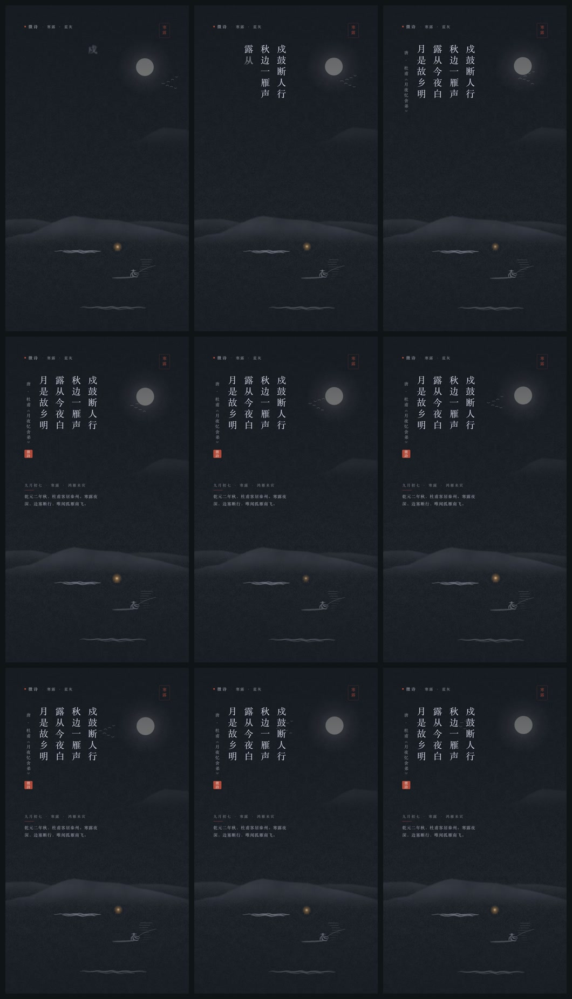
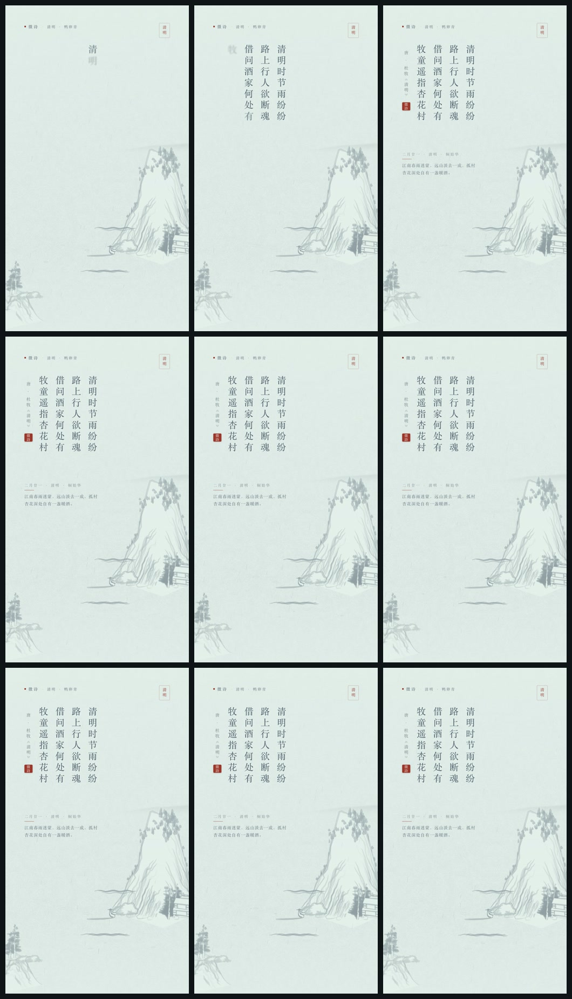
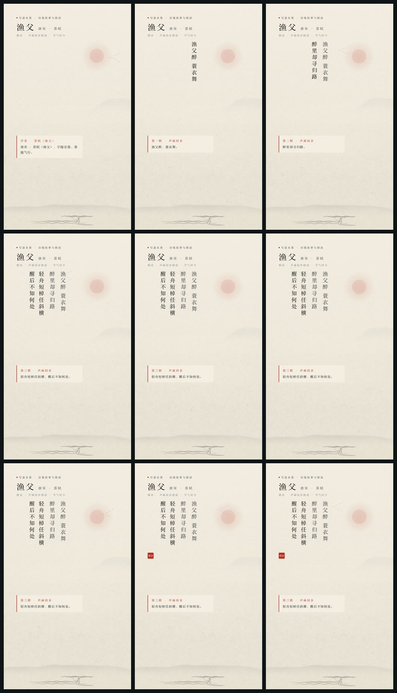
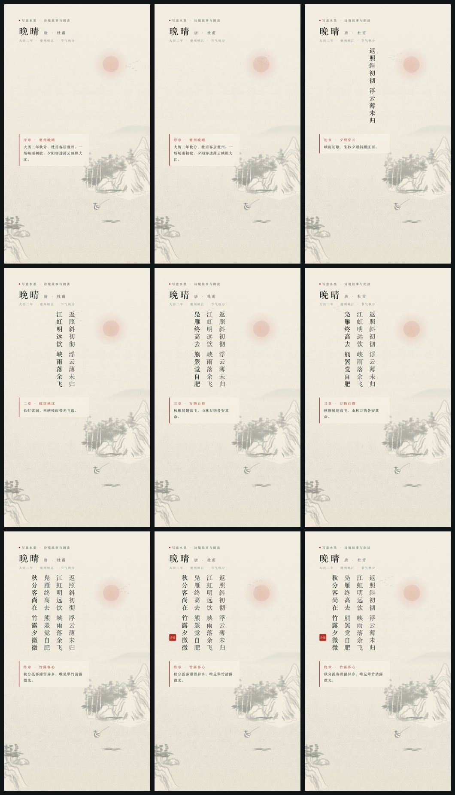
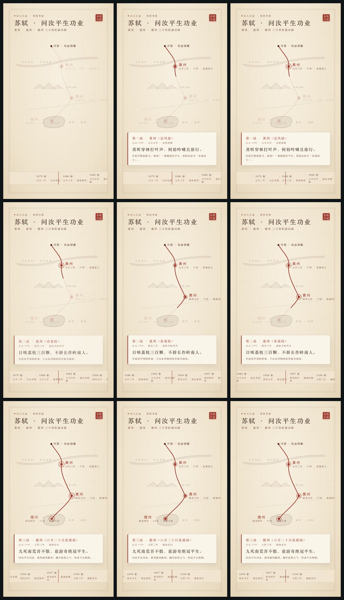
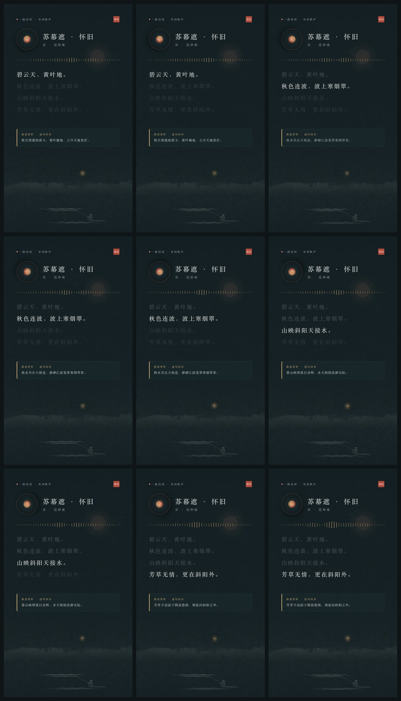
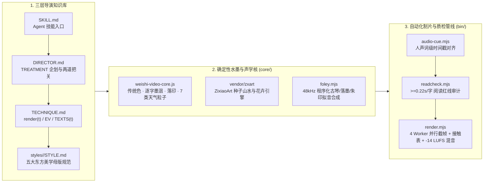

# 微诗视频工作台 · Weishi Video Studio

[](./SKILL.md)
[](https://github.com/charsunny/zixiao-kit)
[](./LICENSE)

**微诗视频工作台（Weishi Video Studio）** 是一套专为中国古典诗词、二十四节气画屏与东方水墨美学打造的 **确定性纯 Web 视频制片引擎与 AI Agent Skill**。

它借鉴并深化了 [`lemomo-ai/lemo-opuscar`](https://github.com/lemomo-ai/lemo-opuscar) 的「将视频视为时间 $t$ 的纯函数 `window.render(t)` + 三层导演文档体系」理念，并与 [子晓套件 `ZixiaoKit`](https://github.com/charsunny/zixiao-kit) 的程序化水墨山水（`ZixiaoArt`）、中国传统色配色系统、真实人声词级对齐（Audio-First Cue Grid）和程序化东方拟音（古琴泛音、落墨、朱印闷响、宣纸翻页）深度融合，彻底解决通用生成式 AI 视频在汉字书法乱码、水墨留白失真与声画脱节上的痛点。

---

## 一、五大东方美学视频母版与实拍接触表 (`examples/`)

每套母版均遵循 `window.render(t)` 确定性契约，支持 `9:16` (`1080×1920`)、`3:4`、`1:1`、`16:9` (`1920×1080`) 多画幅导出与 `readcheck` 字幕停留时长质检：

| 01 动态画屏 (`huaping-motion`)<br>寒露 · 杜甫《月夜忆舍弟》 | 01 动态画屏 (`huaping-motion`)<br>清明 · 杜牧《清明》 |
| :---: | :---: |
|  |  |

| 02 写意水墨 (`ink-story`)<br>苏轼《渔父》· 人声词级同步 + 书法题跋 | 02 写意水墨 (`ink-story`)<br>杜甫《晚晴》· 暖宣五墨 + 夕照江岸 |
| :---: | :---: |
|  |  |

| 03 诗人行迹 (`poet-footprint`)<br>苏轼黄州·惠州·儋州三万里贬谪舆图 | 04 一曲诗词 (`poem-song-mv`)<br>范仲淹《苏幕遮·碧云天》· 唱盘与声波律动 |
| :---: | :---: |
|  |  |

---

## 二、核心架构



---

## 三、作为 AI Agent Skill 安装使用

本仓库根目录包含标准 [`SKILL.md`](./SKILL.md)（同时预置了 `.agents/skills/weishi-video-studio/SKILL.md`），可直接挂载到 **Antigravity / Claude Code / OpenClaw / Cursor**：

```bash
# 方式 1：克隆到项目的 .agents/skills/ 目录（Antigravity / Claude Code 自动发现）
mkdir -p .agents/skills
git clone https://github.com/charsunny/weishi-video-studio.git .agents/skills/weishi-video-studio
cd .agents/skills/weishi-video-studio && npm install

# 方式 2：全局安装到 ~/.gemini/config/skills/ 或 OpenClaw skills 目录
git clone https://github.com/charsunny/weishi-video-studio.git ~/.gemini/config/skills/weishi-video-studio
cd ~/.gemini/config/skills/weishi-video-studio && npm install
```

安装后即可直接对 Agent 下达指令：
> - 「帮我用 `weishi-video-studio` 为苏轼《渔父》做一支写意水墨短视频，先出九宫格接触表给我看」
> - 「用 `huaping-motion` 母版生成一张寒露节气的动态画屏视频」

---

## 四、命令行快速上手

> 环境依赖：**Node.js >= 18**、本机已安装 **Google Chrome**（或设置 `CHROME_PATH`）与 **FFmpeg**。

```bash
git clone https://github.com/charsunny/weishi-video-studio.git
cd weishi-video-studio
npm install
```

### 1. 启动交互式浏览器导演工作台 (`http://127.0.0.1:4180/`)
```bash
npm run preview
# 或: node bin/preview.mjs
```
在浏览器中实时切换预设剧目、按 `Space` 播放/暂停、按 `←`/`→` 逐帧步进检查墨洇与山水动效、点击音效锚点跳转。

### 2. 一键端到端制片 (`produce.mjs`)
自动检索内置/外置朗读音频库 → 生成配方 JSON、[`TREATMENT.md`](./examples/sushi-yufu.treatment.md) 与社区文案 → 跑 `readcheck` 质检 → 4 进程并行渲染 `1080×1920` MP4 + 九宫格接触表 `.sheet.jpg` + 封面图 `.cover.jpg`：
```bash
node bin/produce.mjs --query "苏轼 渔父" --style ink-story --slug sushi-yufu
node bin/produce.mjs --query "杜甫 晚晴" --style ink-story --slug wanqing-dufu
```

### 3. 自动化字幕时长与音效质检 (`readcheck.mjs`)
```bash
node bin/readcheck.mjs --scene huaping-motion --recipe hanlu-dufu
node bin/readcheck.mjs --scene ink-story --recipe sushi-yufu
node bin/readcheck.mjs --scene poet-footprint
```

### 4. 秒级生成九宫格关键帧接触表 (`--sheet-only`)
```bash
node bin/render.mjs --scene huaping-motion --recipe hanlu-dufu --sheet-only
```

### 5. 多进程并行导出高清 MP4 + 三轨自动闪避 `-14 LUFS` 混音
```bash
node bin/render.mjs --scene huaping-motion --recipe hanlu-dufu --workers 4 --sheet
node bin/render.mjs --scene huaping-motion --recipe qingming-dumu --workers 4 --sheet
node bin/render.mjs --scene ink-story --recipe sushi-yufu --workers 4 --sheet
node bin/render.mjs --scene poet-footprint --workers 4 --sheet
```

---

## 五、目录结构

```text
weishi-video-studio/
├── SKILL.md                         # AI Agent Skill 规范入口 (OpenClaw / Claude / Antigravity)
├── DIRECTOR.md                      # 导演企划、TREATMENT 模板与两阶段把关手册
├── TECHNIQUE.md                     # 确定性渲染契约 (window.render(t) / EV / TEXTS(t))
├── workbench.html                   # 交互式浏览器导演工作台 UI
├── core/
│   ├── weishi-video-core.js         # 确定性 PRNG、传统色、逐字墨洇、ZixiaoArt 桥接、7 类天气系统
│   └── foley.mjs                    # 48kHz 程序化东方拟音合成器 (古琴泛音/落墨/朱印闷响/翻页/竹音)
├── vendor/zxart/                    # 内置 ZixiaoArt Web Worker 程序化山水与花卉引擎
├── styles/                          # 五大东方美学风格手册 (STYLE.md)
│   ├── huaping-motion/STYLE.md      # 01 动态画屏 · 节气与每日一诗
│   ├── ink-story/STYLE.md           # 02 写意水墨 · 诗境故事与题跋赏析
│   ├── poet-footprint/STYLE.md      # 03 诗人行迹 · 舆图考据纪实
│   ├── poem-song-mv/STYLE.md        # 04 一曲诗词 · 诗音律动 MV
│   └── living-promo/STYLE.md        # 05 活体实机 · 产品与专题宣发
├── templates/                       # 标准场景模板 (HTML + Canvas + SVG)
├── recipes/                         # 剧目导演配方 JSON
├── assets/                          # 开箱即用的内置示例朗读人声、词级时间戳与环境配乐
├── examples/                        # 实拍九宫格接触表 (.sheet.jpg) 与分镜企划单示例
└── bin/
    ├── produce.mjs                  # 一键端到端制片总控台
    ├── preview.mjs                  # 启动交互式浏览器工作台
    ├── audio-cue.mjs                # 扫描朗读库自动生成人声词级对齐 Recipe
    ├── readcheck.mjs                # 自动审计字幕停留时长 (>=0.22s/字) 与音效触发点
    └── render.mjs                   # 多进程并行截帧、接触表生成与 3 轨 -14 LUFS 混音导出
```

---

## 六、关联开源项目与致谢

- **[`charsunny/zixiao-kit`](https://github.com/charsunny/zixiao-kit)**：子晓古典文化产品矩阵的 Swift 共享内核（含 `ZixiaoArt` 原生 CoreGraphics / SwiftUI 程序化山水花鸟、`ZixiaoDesign` 传统色系统、`ZixiaoCalendar` 二十四节气七十二候历法）。
- **[`lemomo-ai/lemo-opuscar`](https://github.com/lemomo-ai/lemo-opuscar)**：确定性纯 Web 视频渲染与三层导演文档工程方法论启发。
- **[`LingDong-/shan-shui-inf`](https://github.com/LingDong-/shan-shui-inf) & [`LingDong-/nonflowers`](https://github.com/LingDong-/nonflowers)**：`ZixiaoArt` 底层程序化山水与花卉几何生成算法致谢（MIT License）。

## License

[MIT License](./LICENSE) © 2026 charsunny (Zixiao Studio)
